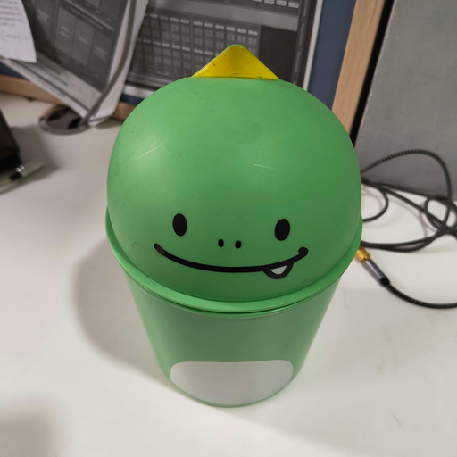
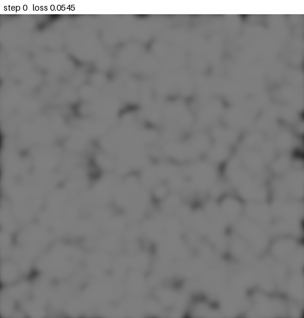
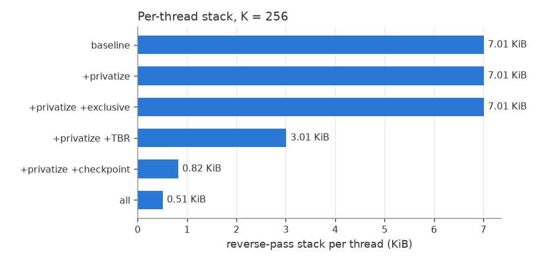
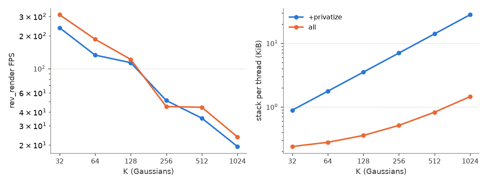

# loma

loma is an educational compiler for differentiable programming, from the course [CSE 291](https://cseweb.ucsd.edu/~tzli/cse291/) at UCSD. Programs are written in a Python-like DSL and compiled to C, ISPC or Slang (GPU). See [this PDF](https://cseweb.ucsd.edu/~tzli/cse291/sp2026/homework0.pdf) for an introduction to the language.

forward and reverse-mode automatic differentiation as source-to-source IR transforms (removed the hw code).
In [extensions/](extensions/), fewer atomics, smaller reverse-mode stacks, race-free gradients in parallel code, and a Slang backend fix.
A 2D Gaussian splatting image fitter written in loma.

#### Extensions

| Extension | What it does | Result | Test |
|---|---|---|---|
| Remove atomics | plain adds for arrays each thread only touches at its own index | atomic removed on `_dx[i]`, kept on the shared `_dy` | `test_exclusive_arrays_c` |
| TBR analysis | skips stack pushes whose values reverse mode never reads | stack 2000 -> 1000 slots, same gradient | `test_tbr_sum_loop` |
| Checkpointing | `checkpoint := k` on a loop: store every k-th state, recompute the rest | stack 500 -> 80 slots, same gradient on C and GPU | `test_checkpoint_auto`, `test_checkpoint_slang` |
| Privatization | per-thread temporaries for helper calls in parallel code | `dx` ~36 (racy) -> 300000.0, the correct value | `test_privatize_race_slang` |

All tests are in [extras/testext.py](extras/testext.py). [docs/results.md](docs/results.md) shows each test program with the generated code before and after.

#### Application: 2D Gaussian splatting

[apps/splat2d/](apps/splat2d/) fits an image using 2D Gaussians. The renderer is a loma `@simd` kernel, one thread per pixel, and its gradient comes from `rev_diff` compiled to Slang. All extensions are on.

<table>
<tr><td align="center">target (512x512)</td><td align="center">fit, 4096 Gaussians</td></tr>
<tr><td></td><td></td></tr>
</table>

Reproduce:

```sh
python apps/splat2d/fit.py --target apps/splat2d/dino.jpg --size 512 --k 4096   # the fit above, ~10 min
python apps/splat2d/fit.py                              # default 256x256 target, 1024 Gaussians -> results/fit.gif
python apps/splat2d/fit.py --target my_image.jpg --k 1024 --save-frames 10
ffmpeg -framerate 20 -i apps/splat2d/results/frames/all/step_%04d.png \
       -vf "scale=256:-1:flags=neighbor" fit.gif        # animation from the saved frames
python apps/splat2d/bench.py                            # memory and speed
```

**Memory.** Reverse-pass stack per thread. This is the stack size loma allocates at compile time.



**Speed.** Backward passes per second (`rev_render` FPS) and stack size as the number of Gaussians grows:



Full numbers: [docs/splat2d/bench.md](docs/splat2d/bench.md).

#### Setup

`note:` this wont work until you implement the homework yourself

```sh
micromamba create -n loma -c conda-forge python=3.11 ispc cmake ninja
micromamba activate loma
uv pip install -r requirements.txt

git submodule update --init --recursive
cd slangpy
uv pip install .
cd ..

python extras/testext.py    # extension tests (slang needs gpu)
```

#### References

- T.-M. Li, [CSE 291: Differentiable Programming](https://cseweb.ucsd.edu/~tzli/cse291/), UCSD, and [loma](https://github.com/BachiLi/loma_public).
- TBR: Hascoët, Naumann, Pascual, *"To be recorded" analysis in reverse-mode AD*, FGCS 2005; Strout, Hovland, *Linearity Analysis for AD*, ICCS 2006.
- Checkpointing: Griewank, Walther, *Algorithm 799: revolve*, ACM TOMS 2000; Bangaru et al., *SLANG.D*, SIGGRAPH Asia 2023.
- Parallel adjoints: Hückelheim, Hascoët, *AD of Parallel Loops with Formal Methods*, 2022; Hückelheim et al., *AD for Adjoint Stencil Loops*, ICPP 2019.
